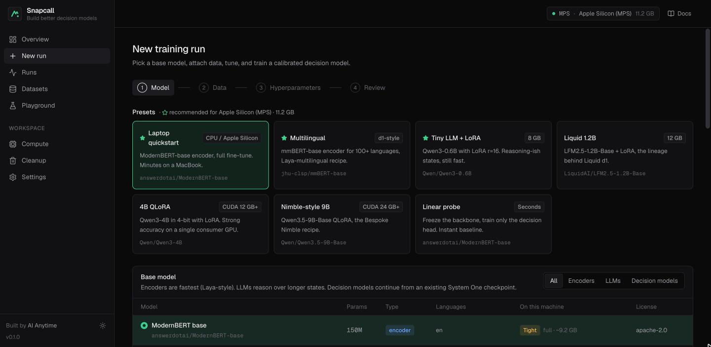
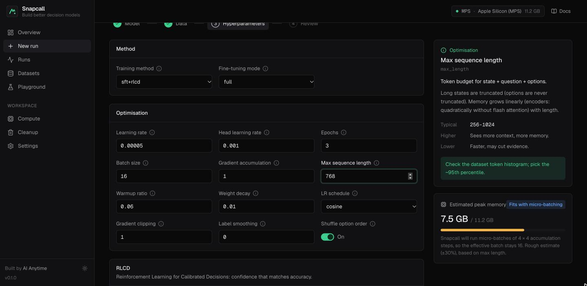
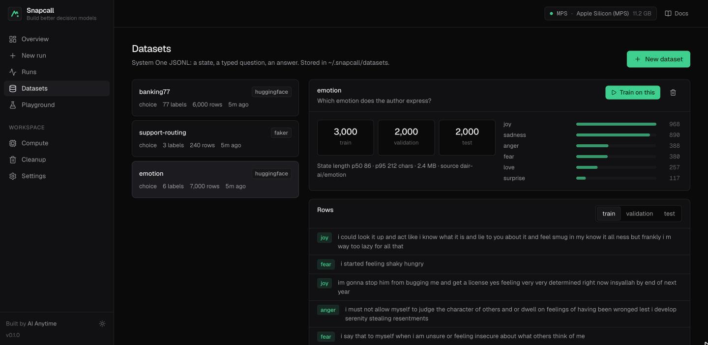
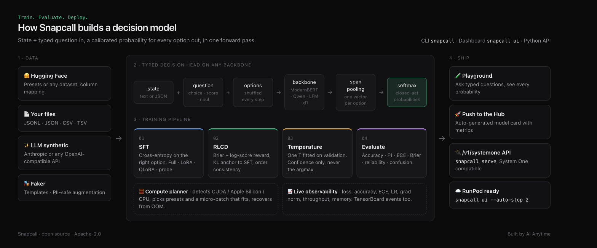

<div align="center">

# ⚡ Snapcall

**Build better decision models.**

An open-source toolkit to **train, evaluate and deploy** calibrated System One decision models (Jev-style):
typed questions in, a real probability for every option out, in one forward pass.

[](https://pypi.org/project/snapcall/)


[](https://github.com/AIAnytime/snapcall/actions/workflows/ci.yml)


**Train. Evaluate. Deploy.**

</div>



```bash
pip install snapcall
snapcall ui
```

That's it: a dashboard opens at `http://127.0.0.1:7860`. Pick a model, attach data, press **Train**.

---

## 🤔 What is a decision model?

Decision models like TypeSafe's **Jev**, Cloudflare's **Clef**, Liquid's **d1**, Convai's **Laya** and
Bespoke's **Nimble** don't write text. You give them a **state** (text or JSON) and **typed questions**, and
they return a **calibrated probability for every option**:

```python
model.decide(
    state="My card still hasn't arrived and I need it for my trip on Friday",
    questions={
        "intent":  {"type": "choice", "instructions": "Which banking intent?",
                    "criteria": {"card_arrival": "Card not delivered", "lost_or_stolen_card": "Card lost"}},
        "urgency": {"type": "score",  "instructions": "How urgent?", "criteria": ["low", "medium", "high"]},
        "upset":   {"type": "noul",   "instructions": "Is the customer upset?"},
    },
)
# {"answers": {"intent": {"choice": "card_arrival", "confidence": 0.97, "probabilities": {...}},
#              "urgency": {"score": 1.82, ...}, "upset": {"noul": 0.71}}}
```

| Type | Answers | Returns |
|---|---|---|
| `choice` | one of 2–255 named options | the top option, its confidence, and a probability for every option |
| `score` | an ordinal level (2–10 levels) | the expected level and a distribution over levels |
| `noul` | yes / no | P(yes) |

They **can't hallucinate an option** you didn't offer, and when they say 0.8 they should be right about 80%
of the time. **Snapcall lets you build your own** on any open model, with your data, on your hardware.

## ✨ Highlights

- 🧠 **Any backbone**: ModernBERT, mmBERT (multilingual), DeBERTa, SmolLM2, LFM2/LFM2.5, Qwen3/3.5, or any Hugging Face id. You can also continue training open decision models (Laya, d1, Tev1, Clef).
- 🎯 **Calibration-first training**: SFT → **RLCD** (Reinforcement Learning for Calibrated Decisions) → temperature scaling.
- 🧮 **Compute-aware**: detects CUDA, Apple Silicon or CPU and shows which models fit before you train. It also picks a micro-batch that fits and recovers from out-of-memory errors automatically.
- 🎛️ **Presets plus explained hyperparameters**: every knob says what it does and what happens when you raise or lower it.
- 📦 **Data four ways**: 🤗 Hugging Face, your own JSONL/CSV, ✨ LLM synthetic data (Anthropic or any OpenAI-compatible API), and 🎭 Faker templates with no key needed.
- 📈 **TensorBoard-style observability**: live loss, accuracy, ECE, Brier, LR, grad norm, throughput and memory, plus reliability diagrams and confusion matrices.
- 🚀 **Ship it**: a playground, one-click push to the Hub with an auto-generated model card, and a System One compatible `/v1/systemone` server.
- ☁️ **Cloud-GPU ready**: on RunPod, `snapcall ui` prints the pod URL, sets a password and can auto-stop the pod.
- 🧹 **Cleanup built in**: checkpoints, event files, failed runs and Hugging Face cache, with sizes shown.

## 🖥️ Tour

|  |  |
|---|---|
| **🎛️ Tune with explainers.** What each knob does, typical values, and a live memory estimate. | **📦 Bring data.** Hugging Face presets, file upload, LLM synthetic data or Faker templates. |

## 🧠 How it works



1. **Typed decision head.** The state, question and options are rendered into one sequence. Each option's token span is pooled (mean for encoders, last token for decoders) and scored by a small head. A softmax over the options gives a closed-set distribution. Options are shuffled every step, so the model learns what an option *means*, not where it sits.
2. **SFT.** Cross-entropy on the correct option (or on soft annotator distributions), with AdamW, warmup, a cosine or linear schedule, gradient accumulation, best-checkpoint restore and early stopping.
3. **RLCD.** TypeSafe has only described RLCD at a high level. Snapcall's version is an open, KL-regularised proper-scoring objective:
   - **reward:** Brier score plus log-score;
   - **anchor:** `β·KL(π ‖ π_SFT)` keeps it close to the SFT model;
   - **consistency:** a term that agrees across shuffled option orders.

   Decisions stay put while confidence gets honest.
4. **Temperature scaling** on the validation split (it never changes the top answer).
5. **Evaluation:** accuracy, macro F1, 15-bin ECE, Brier, NLL, reliability bins and a confusion matrix.

## 📊 Results

Measured on an Apple M3 laptop (16 GB) with `answerdotai/ModernBERT-base` on
[`dair-ai/emotion`](https://huggingface.co/datasets/dair-ai/emotion) (6 emotions), 3,000 training examples,
2 epochs of SFT and 0.5 epochs of RLCD (33 minutes):

| Stage | Val accuracy | Val ECE ↓ |
|---|---|---|
| After SFT | 77.4% | 0.032 |
| After RLCD | **81.6%** | **0.020** |
| **Held-out test** (2,000 examples) | **82.0%** | **0.019** |

ECE is expected calibration error: an ECE of 0.019 means confidence is, on average, within about 2 points of
actual accuracy.

## 🚀 Quickstart

### 🖥️ Dashboard

```bash
pip install snapcall
snapcall ui
```

**New run** → pick a preset or model → pick or create a dataset → tune → **Start training**. The run page
streams metrics and logs, then gives you **Evaluation**, **Model**, **Test**, **Publish** and **Files** tabs.
Training runs in a background process, so you can close the browser.

### ⌨️ CLI

```bash
snapcall doctor                                   # 🧮 hardware + recommendations
snapcall data hf banking77                        # 📦 import a preset HF dataset
snapcall train -p laptop-quick -d banking77       # 🏋️ train with live progress
snapcall runs                                     # 📋 list runs
snapcall predict <run> -s "I was charged twice for my coffee"
snapcall eval <run> --split test                  # 📊 metrics on any split
snapcall push <run> --repo you/banking77-snapcall # 🚀 Hub + model card
snapcall serve <run> --port 8000                  # 🔌 /v1/systemone API
snapcall clean --checkpoints --failed             # 🧹 free disk
```

More: `snapcall models`, `snapcall presets`, `snapcall explain [param]`, `snapcall init`,
`snapcall logs <run> -f`, `snapcall stop <run>`, `snapcall card <run>`, `snapcall tensorboard`,
`snapcall data {list,show,upload,faker,synth}`.

### 🐍 Python

```python
from snapcall import Trainer, TrainConfig, DataConfig, DecisionModel

cfg = TrainConfig(
    base_model="answerdotai/ModernBERT-base",
    data=DataConfig(dataset="banking77"),
    method="sft+rlcd", finetune="full", epochs=3, learning_rate=5e-5,
)
Trainer(cfg, run_dir="runs/banking77").train()

model = DecisionModel.from_pretrained("runs/banking77/model")   # or a Hub repo id
model.decide(state="Where is my new card?", questions={"intent": model.meta["question"]})
```

## 🧩 Models and presets

| Family | Models | Mode | Notes |
|---|---|---|---|
| Encoders | ModernBERT base/large, mmBERT small/base, DeBERTa v3 | full | ⚡ Fastest, Laya-style. Trains on a laptop |
| Small LLMs | SmolLM2, LFM2 350M, LFM2.5 1.2B, Qwen3 0.6B/1.7B/4B | LoRA · QLoRA | Longer states, more reasoning |
| Big bases | Qwen3.5 4B/9B Base | LoRA · QLoRA | Bases of Nimble, Tev1, Decider, kev |
| Laya | `convaiinnovations/laya` (English, 395M), `convaiinnovations/laya:multilingual` (307M) | full · LoRA | ✅ Warm-start from Laya's decision-tuned encoder |
| Other decision models | d1 600M/3B, Tev1 4B, Clef Flash 9B, Clef 27B | LoRA · QLoRA | 🧪 Experimental: continue from an open System One model |

| Preset | For | Base |
|---|---|---|
| `laptop-quick` | 💻 CPU / Apple Silicon | ModernBERT base, full |
| `multilingual` | 🌍 100+ languages | mmBERT base, full |
| `tiny-llm-lora` | 8 GB GPU | Qwen3 0.6B, LoRA |
| `liquid-1b` | 12 GB GPU | LFM2.5 1.2B Base, LoRA |
| `gpu-4b-qlora` | CUDA 12 GB+ | Qwen3 4B, QLoRA |
| `nimble-9b` | CUDA 24 GB+ | Qwen3.5 9B Base, QLoRA |
| `probe` | ⏱️ seconds | frozen backbone, head only |

## 📦 Data

| Source | How |
|---|---|
| 🤗 Hugging Face | Presets (Banking77, Emotion, AG News, SST-2, BoolQ, Yelp, MASSIVE, multilingual sentiment) or any dataset with column mapping |
| 📄 Your files | `.jsonl`, `.json`, `.csv`, `.tsv`: native System One rows or any table with a text and a label column |
| ✨ LLM synthetic | Describe the use case. The LLM proposes the question and options, then writes balanced examples (Anthropic, OpenAI, OpenRouter, Groq, Ollama…) |
| 🎭 Faker | Templates such as `"I was charged {amount} for order {order_id}"`, filled with realistic fake values in 14 locales, no API key |

Real datasets are messy, so imports clean up for you:
- 🧽 Rows with empty text or labels are skipped.
- 🔢 Numeric labels are ordered by value (ratings `1…10`, not `1, 10, 2`).
- ✂️ `--top-labels N` keeps the N most frequent labels, and `--other-label` merges the rest into a catch-all.
- 🏷️ `--multi-label single|first|noul` turns list labels into one choice, or one yes/no question per label.
- 🧱 `--text-col a,b` joins several columns into the state.

```bash
snapcall data hf xamxte/cve-to-cwe --text-col description --label-col cwe_id --top-labels 40
snapcall data hf bigbio/hallmarks_of_cancer --config hallmarks_of_cancer_source --text-col text \
  --label-col label --multi-label noul
```

Faker also does **PII-safe augmentation** at train time: it swaps emails, phones, amounts and IDs, so the
model learns the decision rather than the entities. Every dataset gets stratified train/validation/test splits.

<details>
<summary>📝 Native row format</summary>

```json
{"state": "I was charged twice", "question": {"type": "choice", "instructions": "Route to a team",
  "criteria": {"billing": "Charges, refunds", "shipping": "Delivery"}}, "answer": "billing"}
```

Multi-question rows (`"questions": {...}, "answers": {...}`) are flattened automatically. `score` answers
are level indices, and `noul` answers are booleans. An optional `"soft": {"billing": 0.7, "shipping": 0.3}`
trains on annotator distributions.

</details>

## ☁️ Run on a cloud GPU (RunPod)

```bash
pip install snapcall
snapcall ui --auto-stop 2
```

On a RunPod pod, `snapcall ui` detects the pod and:
- 🔗 prints the proxy URL;
- 🔒 generates a password (proxy URLs are public);
- 💾 keeps runs and models on `/workspace`;
- ⏱️ with `--auto-stop`, stops the pod after N hours so a small balance lasts.

See the **[RunPod guide](deploy/runpod/README.md)** for pod settings and a $2 session plan.

## 🔌 Serving

```bash
snapcall serve <run-or-hub-repo> --port 8000
curl -s localhost:8000/v1/systemone -H 'content-type: application/json' -d '{
  "state": "Where is my new card?",
  "questions": {"intent": {"type": "choice", "instructions": "Which intent?",
                "criteria": {"card_arrival": "Card not delivered", "activate_my_card": "Activation"}}}}'
```

The dashboard server exposes the same endpoint at `/v1/systemone`. Pass `"model": "<run id>"`, or omit it
to use the latest model.

## 🗂️ Workspace

Everything lives in `~/.snapcall` (override with `SNAPCALL_HOME`):
- `datasets/`
- `runs/<id>/`, which holds `config.json`, `status.json`, `metrics.jsonl`, `train.log`, `tensorboard/`, `checkpoints/`, `eval.json` and `model/`
- `settings.json`, which holds API keys (chmod 600)

`HF_TOKEN`, `ANTHROPIC_API_KEY`, `OPENAI_API_KEY` and `OPENAI_BASE_URL` work as fallbacks. To expose the
dashboard beyond localhost, use `snapcall ui --host 0.0.0.0`. It is then password-protected automatically,
or you can set `--password` / `SNAPCALL_PASSWORD`.

## 🛠️ Development

```bash
git clone https://github.com/AIAnytime/snapcall && cd snapcall
cd ui && pnpm install && pnpm build && cd ..   # dashboard -> snapcall/server/static
pip install -e ".[anthropic,dev]"
pytest -q
```

Extras: `snapcall[anthropic]` adds the Anthropic SDK for synthetic data, and `snapcall[qlora]` adds
bitsandbytes for QLoRA on CUDA.

## 🗺️ Limitations and roadmap

- Text states only. Image states and `box` questions are next.
- QLoRA needs CUDA plus bitsandbytes. On Apple Silicon, use LoRA in bf16.
- Qwen3.5, d1, Laya and Clef checkpoints are experimental.
- Large option sets (50+) make sequences long. The memory planner shrinks micro-batches automatically, but training is slower.

## 🤝 Contributing

Issues and PRs are welcome: new backbones, question types, datasets and evals especially.

---

<div align="center">

Built with ❤️ by **[AI Anytime](https://www.youtube.com/@AIAnytime)** · Apache-2.0

</div>
